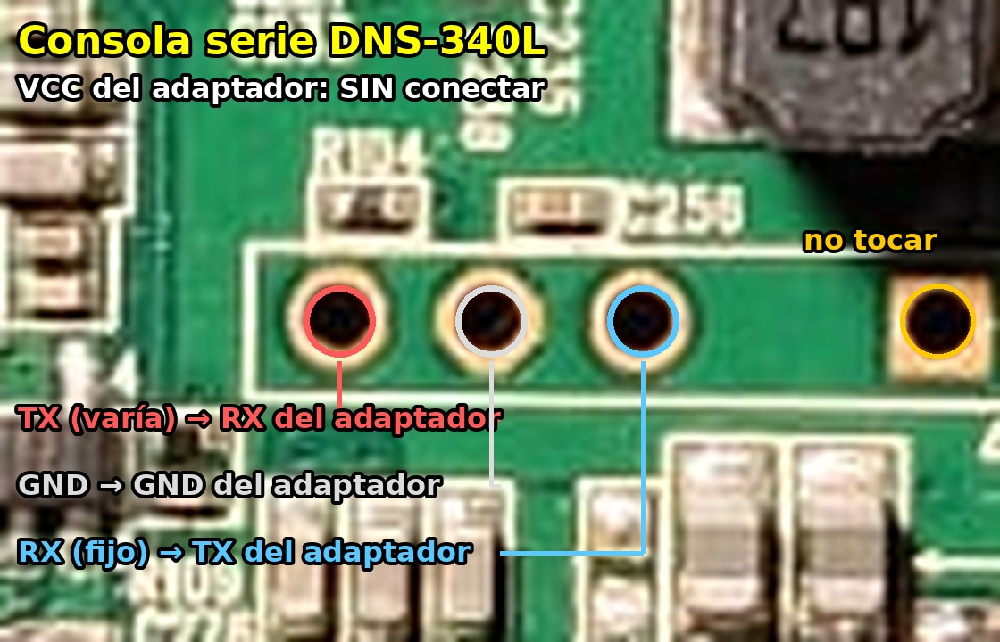

# Consola serie

No es imprescindible para instalar (se puede grabar todo desde el firmware de D-Link), pero es **la red de
seguridad**: con ella se entra en U-Boot y se puede arrancar o grabar cualquier núcleo por TFTP.

## Conector

Hay que abrir la carcasa. La consola es un conector de **3 pines** en el centro de la placa, debajo de la
bobina marcada "4R7", entre el chip Etron y el procesador.

| Pin (con los conectores de red hacia abajo) | Señal | Adaptador USB-TTL |
|---|---|---|
| Izquierdo | TX del NAS | **RXD** |
| Central | GND | **GND** |
| Derecho | RX del NAS | **TXD** |

* El pin de **VCC del adaptador no se conecta**.
* Usa un adaptador de **3,3 V** (CP2102, FT232RL…).
* Parámetros: **115200 8N1**, sin control de flujo.
* El agujero cuadrado que hay a la derecha, fuera del recuadro, no se ha identificado: no conectar.

Otros conectores de la placa:
* **JP1** (4 pines, junto a la 3.ª bahía): ninguno de sus pines es masa; función desconocida.
* **JP4** (4 pines, junto al Weltrend): programación del microcontrolador. **No usar.**
* **2 × 5 pines** (junto a la memoria): JTAG.

## Identificar los pines con un polímetro

1. Apagado, en continuidad: el pin que pita con la carcasa metálica de un USB es **GND**.
2. Encendido, en tensión continua: el pin cuya tensión **oscila** durante el arranque es **TX**; el que se queda fijo en ~3,3 V es **RX**.

## La entrada de la consola puede no funcionar

En uno de los equipos probados **solo funciona la salida** (se ve todo el arranque, pero el NAS no recibe nada):
ni U-Boot, ni el arranque por UART del BootROM (`kwboot`), ni SysRq del núcleo responden. Medido:

* El cable hace contacto con el agujero derecho, y ese pin está unido a la alimentación por ~9,5 kΩ.
* El pin derecho va a **R104** (encima del pin izquierdo), que mide **≥ 5,7 kΩ** dentro de la placa. Una
  resistencia tan grande en serie, con una resistencia de subida al otro lado, impediría que la línea baje a 0.
* Apoyar el TXD del adaptador en el otro extremo de R104 tampoco funcionó (contacto difícil: es un 0603).

Sin confirmar. Si la consola no recibe, la alternativa es grabar la flash por SSH desde el firmware de D-Link
(ver [instalacion.md](instalacion.md)).

## Entrar en U-Boot

Encender el NAS y pulsar la tecla `1` durante la cuenta atrás (las demás no la paran, ver [u-boot.md](u-boot.md)). Aparece `Marvell>>`.
U-Boot: `U-Boot 2011.12 (Mar 10 2014) Marvell version: v2011.12 2013_Q1.2`.

**Solución (3-11-2026):** el adaptador estaba bien (prueba de bucle TX-RX correcta) y la placa también.
En el conector hay **tres patillas juntas y una separada: la separada es la RX del NAS**. Conectando ahí
el TX del adaptador (3,3 V, GND común, VCC sin conectar) U-Boot recibe las teclas: con `1` se para en
`Marvell>>`. Así se recuperó el equipo 1: desde U-Boot, `setenv usbActive 0; usb reset` (el U-Boot solo
mira un puerto USB trasero; con el otro valor no ve la memoria), `fatload` del `uImage` y el `uInitrd`
desde una memoria FAT32 y `nand erase` + `nand write.e` en `0x500000` y `0xa00000` (ver instalacion.md).
