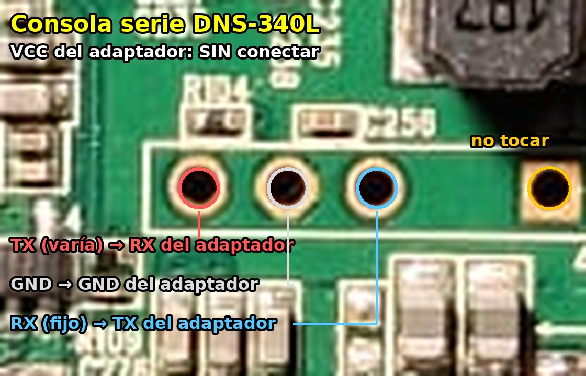

# Consola serie

No es imprescindible para instalar (se puede grabar todo desde el firmware de D-Link), pero es **la red de
seguridad**: con ella se entra en U-Boot y se puede arrancar o grabar cualquier núcleo desde una memoria USB.

## Conector

Hay que abrir la carcasa. La consola está en el centro de la placa, debajo de la bobina marcada "4R7",
entre el chip Etron y el procesador: **tres pines juntos en un recuadro y un agujero cuadrado aparte**, a la
derecha, fuera del recuadro.



| Punto (con los conectores de red hacia abajo) | Señal | Adaptador USB-TTL |
|---|---|---|
| Pin izquierdo del recuadro | TX del NAS | **RXD** |
| Pin central del recuadro | GND | **GND** |
| **Agujero cuadrado aparte** (a la derecha, fuera del recuadro) | **RX del NAS** | **TXD** |
| Pin derecho del recuadro | no es RX (unido a la alimentación por ~9,5 kΩ) | sin conectar |

* El pin de **VCC del adaptador no se conecta**.
* Usa un adaptador de **3,3 V** (CP2102, FT232RL…). La RX del NAS está a unos 3,3 V en reposo.
* Parámetros: **115200 8N1**, sin control de flujo.

Probado el 3-11-2026 en el equipo 1: durante semanas creímos que la entrada de la consola estaba estropeada
porque el TXD del adaptador iba al pin derecho del recuadro. Con el agujero aparte, U-Boot recibe las teclas.

Otros conectores de la placa:
* **JP1** (4 pines, junto a la 3.ª bahía): ninguno de sus pines es masa; función desconocida.
* **JP4** (4 pines, junto al Weltrend): programación del microcontrolador. **No usar.**
* **2 × 5 pines** (junto a la memoria): JTAG.

## Comprobar el adaptador

Une TXD y RXD del adaptador (sin conectarlo al NAS) y escribe en el terminal: si ves lo que escribes, el
adaptador envía y recibe bien.

## Entrar en U-Boot

Encender el NAS y pulsar la tecla `1` durante la cuenta atrás (las demás no la paran, ver
[u-boot.md](u-boot.md)). Aparece `Marvell>>`.
U-Boot: `U-Boot 2011.12 (Mar 10 2014) Marvell version: v2011.12 2013_Q1.2`.

Desde Linux: `sudo picocom -b 115200 -f n /dev/ttyUSB0` (salir con Ctrl+A, Ctrl+X).

## Recuperar un equipo desde U-Boot

Así se recuperó el equipo 1, que tenía grabado un núcleo que no arrancaba:

```
setenv usbActive 0
usb reset
fatload usb 0:1 0x2000000 /uImage
nand erase 0x500000 0x500000
nand write.e 0x2000000 0x500000 0x400000
nand read.e 0x3000000 0x500000 0x400000
cmp.b 0x2000000 0x3000000 ${filesize}
fatload usb 0:1 0x2000000 /uInitrd
nand erase 0xa00000 0x500000
nand write.e 0x2000000 0xa00000 0x300000
nand read.e 0x3000000 0xa00000 0x300000
cmp.b 0x2000000 0x3000000 ${filesize}
```

* Este U-Boot solo mira **uno** de los dos puertos USB traseros: con `usbActive 1` (el valor por defecto en
  el equipo 1) no veía la memoria; con `usbActive 0` sí.
* La memoria tiene que ser **FAT32**. U-Boot lee también carpetas (`/carpeta/uImage`).
* Es normal el aviso de bloque defectuoso en `0x920000`: `write.e` lo salta.
* **Nunca** escribas por debajo de `0x500000`: ahí está U-Boot.
* Para probar sin grabar: `fatload usb 0:1 0xa00000 /uImage`, `fatload usb 0:1 0xf00000 /uInitrd`,
  `bootm 0xa00000 0xf00000`.
