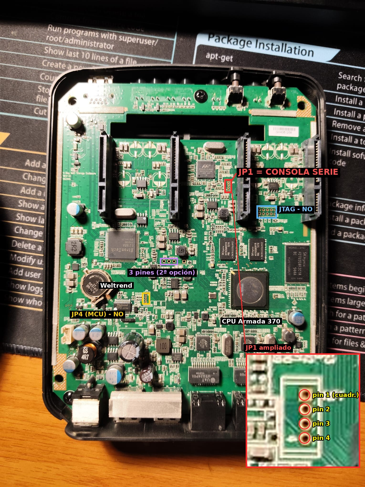

# Hardware del DNS-340L (revisión A1)

Datos obtenidos del firmware 1.08b01 (`dmesg`, `lspci`, `/proc/mtd`), del U-Boot original y de pruebas con Linux 6.12.



## Componentes

| Componente | Detalle |
|---|---|
| Procesador | Marvell Armada 370 (88F6707), núcleo PJ4B ARMv7, 1,2 GHz |
| Memoria | 512 MiB DDR3 (SK hynix) |
| Flash | NAND Hynix 256 MiB (ID `0xad 0xda`), página 2 KiB, bloque 128 KiB, ECC BCH 4 bits |
| Registros internos | `0xf1000000` (así los deja U-Boot) |
| SATA | **Marvell 88SE9215** (PCIe `1b4b:9215`), AHCI, 4 puertos a 6 Gbps → las 4 bahías |
| SATA interno del Armada | 2 puertos (`sata_mv`), sin conectar |
| USB 3.0 | **Etron EJ168** (PCIe `1b6f:7023`) → puerto delantero azul. En Linux 6.12 queda en D3cold (sin alimentación) |
| USB 2.0 | Controladores internos `f1050000` (bus 1) y `f1051000` (bus 2) → los dos puertos traseros |
| Red | 2 × `mvneta` con PHY **Marvell 88E1510** (id `0x01410dd1`) en las direcciones MDIO **0** (eth0) y **1** (eth1), modo `rgmii-id` |
| Microcontrolador | **Weltrend WT6701** en `ttyS1` a 115200 → ventilador, botón, LED de encendido, reloj, encendido programado. Ver [microcontrolador.md](microcontrolador.md) |
| I2C | Dispositivo en `0x4a` (el firmware de D-Link lo registra como `cs42l51`, herencia de la placa de referencia). `mcu_upgrade` usa `/dev/i2c-0` para reprogramar el microcontrolador |
| Reloj interno | El RTC del Armada no funciona ("not ticking"); el reloj lo lleva el microcontrolador |
| Consola | `ttyS0`, 115200 8N1. Conector de 3 pines en el centro de la placa ([consola-serie.md](consola-serie.md)) |

## PCIe

```
00:01.0  puerto PCIe 0  →  01:00.0  Etron EJ168 (xHCI)
00:02.0  puerto PCIe 1  →  02:00.0  Marvell 88SE9215 (AHCI)
```

## Particiones de la NAND (firmware de D-Link)

| mtd | Nombre | Desplazamiento | Tamaño | Uso con este proyecto |
|---|---|---|---|---|
| mtd0 | u-Boot | `0x0000000` | 5 MiB | U-Boot original. **No tocar.** Variables en `0x400000` (512 KiB) |
| mtd1 | uImage | `0x0500000` | 5 MiB | **Núcleo Linux 6.12** (U-Boot lee 4 MiB) |
| mtd2 | ramdisk | `0x0a00000` | 5 MiB | **Arranque / rescate** (U-Boot lee 3 MiB) |
| mtd3 | image.cfs | `0x0f00000` | 206 MiB | Sistema de D-Link (sin uso) |
| mtd4 | rescue firmware | `0xdd00000` | 15 MiB | Recuperación de D-Link (sin uso) |
| mtd5 | config | `0xec00000` | 10 MiB | Configuración de D-Link (UBIFS) |
| mtd6 | mydlink | `0xf600000` | 10 MiB | mydlink (UBIFS) |

Observaciones:
* La unidad analizada tenía 10 bloques defectuosos; uno en `0x920000`, dentro de `mtd1` pero fuera de los 4 MiB que lee U-Boot.
* La partición `config` registraba **~70 000 ciclos de borrado** por bloque: el firmware de D-Link escribe en ella continuamente. Otro motivo para no usar la NAND en Debian.

## GPIO y MPP

Configuración de la placa `RD-88F6710_ALpha_DNS340L` en U-Boot y en el núcleo de D-Link (idéntica salvo lo indicado):

* **MPP** (registros `0xf1018000`–`0xf1018020`): `0x11101111 0x11111111 0x22222111 0x02222222 0x11111110 0x01111111 0x00000000 0x00220000 0x00000000`.
  MPP 47–59 son GPIO; MPP 60–61 son `uart1` (microcontrolador).
* **Salidas** (banco 1): GPIO 47–59.
* **Valores iniciales**: U-Boot deja a 1 los GPIO **48, 49, 50**; el núcleo de D-Link pone a 1 los **47, 48, 49** (y 50 a 0). La función de 47–49 no se ha identificado (no alimentan bahías: las 4 funcionan sin tocarlos).
* **LED**: el programa `led` de D-Link escribe en los registros `0x18140` (salida) y `0x18148` (parpadeo) los bits 18, 19, 25, 26 y 27 → **GPIO 50, 51, 57, 58, 59**.
* Valor alto en GPIO 4 (banco 0) y GPIO 65 (banco 2) en ambos casos.
* **Firmware de D-Link en marcha** (segundo equipo, leído con `devmem`): MPP idéntico al anterior;
  salidas GPIO 47–59 (`0xf1018144` = `0xF0007FFF`), con valor alto en **47–51** y bajo en 52–59
  (`0xf1018140` = `0x800F8000`); bancos 0 y 2 sin salidas. Ningún script de D-Link toca GPIO para el
  USB 3.0: el Etron funciona con el controlador propio de Etron (`etxhci_hcd_131016`, dentro del núcleo).
* **PCIe con el firmware de D-Link:** los dos enlaces activos (`0xf1041a04` = `0x00010000`,
  `0xf1081a04` = `0x00010100`, bit 0 = 0); Etron en el puerto 0 (bus 0), 88SE9215 en el puerto 1 (bus 1).

## Tamaño máximo de volumen

El núcleo es de **32 bits**: un dispositivo de bloques no puede superar **16 TiB**. Con 4 × 4 TB en RAID 5 (10,9 TiB) no hay problema; con discos de 8 TB habría que dividir los datos en dos RAID.
