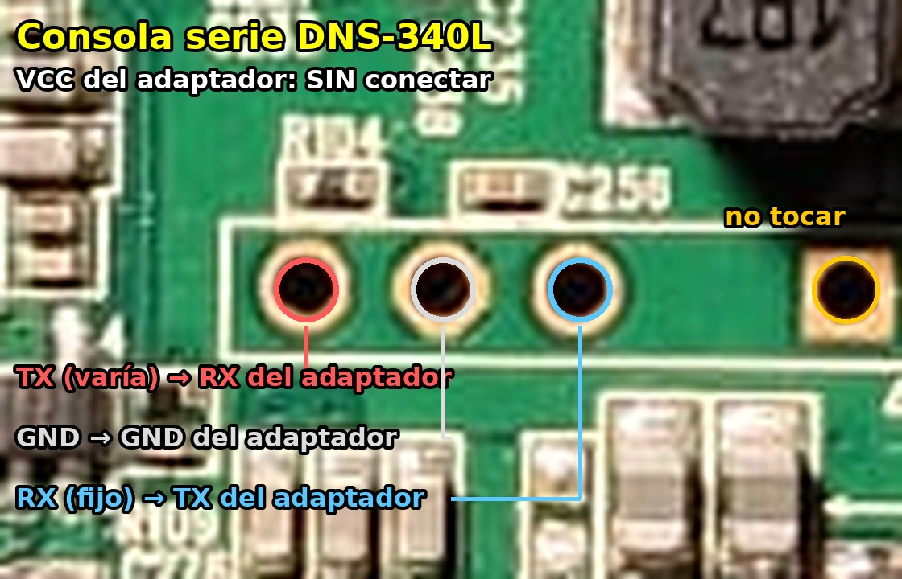

# Serial console

It is not essential for the installation (everything can be written from the D-Link firmware), but it is
**the safety net**: with it you get into U-Boot and can boot or write any kernel from a USB stick.

## Header

You have to open the case. The console is in the middle of the board, below the inductor marked "4R7",
between the Etron chip and the processor: **three pins together inside a printed outline and a separate
square hole**, to the right, outside the outline.



| Point (with the network connectors facing down) | Signal | USB-TTL adapter |
|---|---|---|
| Left pin inside the outline | NAS TX | **RXD** |
| Middle pin inside the outline | GND | **GND** |
| **Separate square hole** (right, outside the outline) | **NAS RX** | **TXD** |
| Right pin inside the outline | not RX (tied to the supply through ~9.5 kΩ) | not connected |

* **Do not connect the adapter's VCC pin.**
* Use a **3.3 V** adapter (CP2102, FT232RL…). The NAS RX idles at about 3.3 V.
* Settings: **115200 8N1**, no flow control.

Tested on 3 November 2026 on unit 1: for weeks we believed the console input was broken because the adapter's
TXD went to the right pin of the outline. With the separate hole, U-Boot receives the keys.

Other headers on the board:
* **JP1** (4 pins, next to the 3rd bay): none of its pins is ground; unknown function.
* **JP4** (4 pins, next to the Weltrend): microcontroller programming. **Do not use.**
* **2 × 5 pins** (next to the memory): JTAG.

## Checking the adapter

Join the adapter's TXD and RXD (without connecting it to the NAS) and type in the terminal: if you see what
you type, the adapter sends and receives correctly.

## Getting into U-Boot

Power on the NAS and press the `1` key during the countdown (other keys do not stop it, see
[u-boot.md](u-boot.md)). `Marvell>>` appears.
U-Boot: `U-Boot 2011.12 (Mar 10 2014) Marvell version: v2011.12 2013_Q1.2`.

From Linux: `sudo picocom -b 115200 -f n /dev/ttyUSB0` (exit with Ctrl+A, Ctrl+X). On Windows, PuTTY with
flow control set to "None".

## Recovering a unit from U-Boot

This is how unit 1 was recovered after a kernel that did not boot had been written to it:

```
setenv usbActive 0
usb reset
fatload usb 0:1 0x2000000 /uImage
nand erase 0x500000 0x500000
nand write.e 0x2000000 0x500000 0x400000
nand read.e 0x3000000 0x500000 0x400000
cmp.b 0x2000000 0x3000000 ${filesize}
fatload usb 0:1 0x2000000 /uInitrd
nand erase 0xa00000 0x500000
nand write.e 0x2000000 0xa00000 0x300000
nand read.e 0x3000000 0xa00000 0x300000
cmp.b 0x2000000 0x3000000 ${filesize}
```

* This U-Boot only scans **one** of the two rear USB ports: with `usbActive 1` (the default on unit 1) it did
  not see the stick; with `usbActive 0` it did.
* The stick must be **FAT32**. U-Boot also reads folders (`/folder/uImage`).
* The bad block warning at `0x920000` is normal: `write.e` skips it.
* **Never** write below `0x500000`: that is where U-Boot lives.
* To try without writing: `fatload usb 0:1 0xa00000 /uImage`, `fatload usb 0:1 0xf00000 /uInitrd`,
  `bootm 0xa00000 0xf00000`.
* Power cycle instead of using `reset`: the SoC's software reset may hang.
